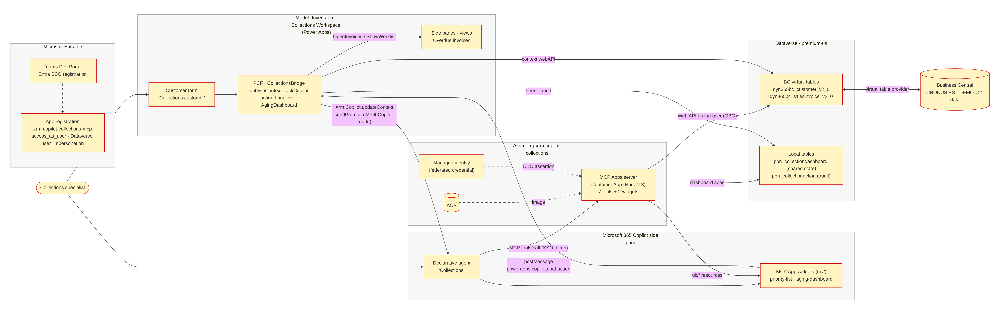
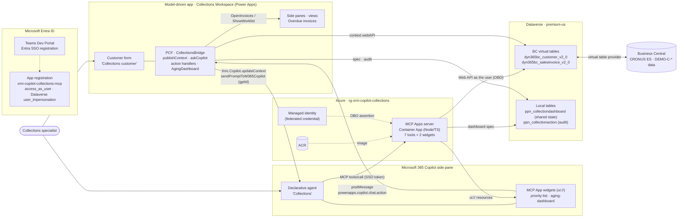

# Build chronology and architecture

How the Collections Workspace demo ("Building the Bridge", D365 Community Summit, Lisbon, 27 Nov 2026)
was built and deployed, in the order it happened. Every tenant change was made by a script in this
repository or by Microsoft's model-apps `app-builder` skill, so the same path can be replayed
(see [setup.md](setup.md), *Scripted path*).

## Architecture

| Surface | What runs there | Talks to |
|---|---|---|
| Model-driven app | PCF `ppn_Contoso.CollectionsBridge` on the *Collections customer* form | Copilot pane (`Xrm.Copilot`), Dataverse (`context.webAPI`) |
| Microsoft 365 Copilot | Declarative agent *Collections* (default agent of the app), MCP App widgets | MCP server (tools, `ui://` widgets), the app (widget `postMessage` actions) |
| Azure Container Apps | MCP Apps server, `DATA_MODE=dataverse`, `AUTH_MODE=entra`, scoped to `DEMO-C-` customers | Dataverse Web API as the signed-in user (OBO via managed identity federated credential) |
| Dataverse | BC virtual tables (live ERP data), `ppn_` tables (shared dashboard state, audit) | Business Central through the virtual table provider |

## Chronology

### 1. Plan and research (repo: `PLAN.md`)
1. Read the current Microsoft Learn pages for `Xrm.Copilot` (GA: prompts, panel, availability, action
   handlers; preview: `executeEvent`/`executePrompt`; `updateContext` listed GA but called preview on the
   maker page), the model-driven Copilot customization page and MCP Apps in Microsoft 365 Copilot.
2. Wrote the plan: three demo beats, the bridge contract, shared state, phases, risks
   (#1: whether `updateContext` reaches a declarative agent).

### 2. Session deck (repo: `deck/`)
3. Built the deck from the AIERP Summit template with `deck/build_deck.py` (python-pptx: duplicate
   template slides, replace text, native code panels and diagram), 27 slides with speaker notes.
4. Fixed a PowerPoint repair prompt (stale template section list), the title slide (speaker photo in
   the template's rounded glow frame) and diagnosed corrupted chat downloads (GitHub download works).

### 3. The code (repo: monorepo)
5. Built the monorepo: `packages/contract` (actions, payloads, allow-list), `packages/collections-domain`
   (aging, payment behaviour, prioritisation, FetchXML, fixtures), `packages/collections-ui` (shared React
   components), `mcp-server` (7 tools, 2 `ui://` widgets, Dataverse repository with OBO), `pcf/CollectionsBridge`,
   `agent/` (declarative agent), `dataverse/` definitions, `mock/` (offline host) and docs. 103 tests, CI.
6. Deck v2: real code on the code slides, mock-host screenshots on the recap slides, *Tools that return UI* slide.

### 4. Tenant preparation
7. Installed .NET 10, Power Platform CLI 2.15, Azure CLI 2.92 and saved them as the cloud environment's
   setup script. Renamed the Dataverse prefix to `ppn_`.
8. Wrote the deploy scripts (`deploy/`): `azure.sh`, `bc-seed.mjs`, `dataverse.sh`, all with `--dry-run`.
9. Signed in with device codes: `pac` and `az` as the same maker; later the Microsoft 365 account for
   publishing the agent (the Agents Toolkit CLI's browser sign-in can't complete from a container).
10. Read-only checks: two publishers with prefix `ppn` (reused **PowerPlatformNinja**), BC virtual table
    solutions installed but no tables yet, *M365 Copilot in model-driven apps* off, Azure resource providers
    not registered.

### 5. Dataverse, pass 1 (Microsoft model-apps `app-builder`)
11. Created solution `CollectionsWorkspace` under PowerPlatformNinja (the skill's `provision-solution.js`).
12. Authored the App Spec (`dataverse/app-builder/app-spec.json`), linted and previewed it, and built pass 1
    without the BC tables: `ppn_collectiondashboard`, `ppn_collectionaction`, views, forms, the app and the
    *Collections Specialist* role. Verified 43/43.

### 6. Business Central demo data (`deploy/bc-seed.mjs`)
13. Created 25 `DEMO-C-*` customers from the repository fixtures (Fabrikam is the hero).
14. Fixed what blocked posting in CRONUS ES: copied posting groups (NAC), payment method (BANCO) and reminder
    terms onto the demo customers through the `workflowCustomers` OData page (API v2.0 can't set them), and
    picked a payment term per invoice (ES max days till due date).
15. Posted 300 invoices, then 269 payments through a general journal batch (the API can't post customer
    payment journals here), with the customer and applies-to invoice set through `workflowGenJournalLines`
    and a canary payment checked first. Result: 269 paid and closed, 31 open (EUR 221k), Fabrikam's
    EUR 48,500 invoice 100 days overdue on 27 Nov.

### 7. Azure and Entra (`deploy/azure.sh`)
16. Registered the resource providers, created resource group `rg-xrm-copilot-collections`, Log Analytics,
    Container Apps environment, ACR (image built from a minimal context after the full repo upload failed),
    a managed identity with AcrPull, the app registration `xrm-copilot-collections-mcp` with a federated
    credential for the identity (OBO without secrets), and the Container App. Health check OK, `/mcp` returns 401
    without a token.
17. Granted admin consent for Dataverse `user_impersonation`.

### 8. The agent (`deploy/agent.mjs`)
18. Created the Entra SSO registration in the Teams Developer Portal, exposed its Application ID URI on the app
    registration with the token store pre-authorized, made the MCP server accept that audience, built the app
    package, imported it into the Developer Portal and uploaded it to Microsoft 365. *Collections* appears in
    Microsoft 365 Copilot.

### 9. App wiring
19. Pushed the PCF into `CollectionsWorkspace` (`pac pcf push`, which also ran *Publish All* in the environment).
20. Turned on *Enable M365 Copilot in model-driven apps* for this app only (`deploy/app-settings.sh`).
21. In the app designer's Agents panel, *Collections* was set as the default agent (stored in environment variable
    `ppn_M365CopilotDefaultAgent_collectionsworkspace` = `T_…​.declarativeAgent`).

### 10. Business Central linked: pass 2
22. Linked BC and Dataverse (manual), made `customer` and `salesInvoice` visible in the catalog (virtual tables generated).
23. Corrected `schema.ts` to the generated names (entity sets, customer lookup) and found the provider's limits:
    FetchXML `top` returns one row, `remainingAmount` can't be filtered or ordered, `olderthan-x-days` needs ≥ 1.
    Builders, views and the MCP repository changed accordingly (status = Open), with tests.
24. Scoped the demo to `DEMO-C-*` (views and `CUSTOMER_NUMBER_PREFIX` on the server): CRONUS ES has its own
    customers with the same names.
25. App-builder pass 2: BC views, the *Collections customer* form with an overdue-invoices sub-grid, the
    existing customer → invoice relationship, the app's form list. Verified 63/63.
26. Redeployed the MCP server, shipped PCF 1.0.1 as a solution import without *Publish All*
    (`deploy/pcf-import.sh`) and bound it to the customer number on the form with the agent id
    (`deploy/bind-pcf.mjs`).

### 11. Payment history on live data
27. Compiled `bc/CollectionsLedgerApi` with the AL CLI against BC 29.1 ES symbols from Microsoft's public symbol
    feeds (the environment's dev endpoint refused symbol downloads), installed it as a per-tenant extension through the
    automation API and generated its virtual table `dyn365bc_customerledgerentry_ppn_collections_v1_0`
    (`deploy/bc-extension.sh`).
28. Fixed one more provider limit (OData `or` across different fields) and ran the MCP tool handlers against the live
    tenant: Fabrikam's payment behaviour is *worsening* (recent 58 vs prior 29 days late, risk 82) and its EUR 48,500
    invoice ranks first to call today. Redeployed the MCP server.

29. Added a demo date (`DEMO_AS_OF`) for rehearsals: with 2026-11-27 the live tenant shows the session-day story
    (Fabrikam 39.7 days late on average and worsening; EUR 48,500 at 100 days, 90+, call today). PCF 1.0.2.

### 12. Deck v3
30. Rebuilt the deck with what the live build taught us: a *How we built it* timeline, *Sharp edges: BC virtual
    tables* and *Sharp edges: building it for real*, and verified facts on the architecture, ERP, GA/preview,
    licensing and checklist slides (31 slides, Open XML SDK validation clean). The recap slides keep the mock-host
    screenshots until the end-to-end run in the tenant.

### 13. Merge and docs from the live tenant
31. Merged the build into `main` (pull request #1). The CI job never started in this repository (GitHub Actions
    account/billing block), so the 107 tests were run locally.
32. Rewrote [demo-script.md](demo-script.md) with the real clicks, prompts and the numbers the tenant shows on the
    session date, and [production-readiness.md](production-readiness.md) with what the build taught us: per-app Copilot
    setting and default-agent variable, BC virtual table limits, SSO and secret-less OBO, PCF update and re-bind
    steps, app-builder caveats, BC seeding gaps and the VERIFY points still open.

### 14. End-to-end run in the tenant (14–15 Nov)
33. Copilot didn't appear in the app: `isM365CopilotEnabled()` returned `false` with the app, environment and licence
    settings on. The missing switch was tenant level: Microsoft 365 admin center → Copilot → Settings → *Business
    Applications data in Work IQ available to Copilot* was **None**.
34. Added a one-line request log to the MCP server. It showed the agent never called its tools from the app pane: it
    answered from Work IQ, and the app's `updateContext` payload doesn't reach an authored agent (risk #1, confirmed).
    The same prompt in Microsoft 365 Copilot did call the tools (silent SSO, OBO, live BC data).
35. Made tool use reliable: the app's prompt names the customer and the tools, plus `discourage_model_knowledge`, a
    plugin `description_for_model` and step-by-step instructions. Beat 2 then ran 3/3: three tool calls, the widget in
    the app's pane, the chase-today list in the control, side panes for the critical invoices.
36. Fixes from watching it live: badges that wrapped, the same next step in widget and app, a *Collections invoice*
    form for the side panes (app-builder; the generated one-field form removed from the app), side panes on click
    instead of automatically, BC fields read-only on the app's forms.
37. Beat 3: the in-app dashboard included CRONUS ES's own customers (€785k vs €125k); the control now gets the server's
    customer scope. Widget → app sync worked; app → agent didn't until `get_dashboard` could return the latest dashboard
    without an id and the app got an **Ask Copilot** button. Typed questions then worked too.
38. Added a **Build aging dashboard** button (no typing on stage) and fixed the dashboard table's clipped totals.
    PCF 1.0.9, agent 1.0.4, 113 tests.

### 15. Deck v4
39. Recap slides with screenshots from the tenant run, recap texts and the shared-state slide matching the confirmed
    behaviour, and a new *Sharp edges: the Copilot pane* slide (32 slides, Open XML SDK validation clean).
### 16. Before/after switch (26 Nov)
40. A demo-only **Share context with Copilot** switch on the control (`SHOW_CONTEXT_SWITCH=true` in `tenant.env`). Off: the
    app withdraws its context and Analyze asks about "this customer", so the agent asks which one (the instructions forbid
    guessing from Work IQ). On: the normal grounded prompt. PCF 1.0.10, agent 1.0.5, 114 tests.

## Still open

- A timed rehearsal and a fallback recording; cleaner full-width screenshots for the recap slides if wanted.
- The bonus beat (propose a follow-up, confirm in the app) has not been run in the tenant.
- The week of the session: re-verify the GA/preview map. After it: set `DEMO_AS_OF` empty and redeploy.
